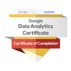

# Hi, I'm John Priest, MBA, MS! 👋

I’m a healthcare operations executive and data analyst with over 10 years of leadership experience turning complex clinical, operational, and financial datasets into measurable business outcomes. Combining an **MBA**, an **M.S. in Health Science**, and hands-on **Lean Six Sigma process improvement leadership**, I bridge the gap between technical data analysis (SQL, BigQuery, Python, Tableau) and executive decision-making.

My experience leading multi-site laboratory operations, optimizing workflows, and ensuring strict regulatory compliance (including HIPAA, CLIA, CAP, and COLA) has prepared me to audit high-stakes datasets and deliver high-impact analytical solutions.

## 🔍 How I Drive Impact with Data  
Throughout my career, data has been central to how I solve operational and financial problems:  
- **Cost & Vendor Optimization:** Extracted and transformed 52,300+ rows of raw MEDITECH LIS data to eliminate redundant daily quality control testing, reducing nightly control volume by **45% (from 29 to 16)** and optimizing vendor supply contracts.  
- **Process & Turnaround Time Engineering:** Led a cross-functional Lean Six Sigma root-cause data analysis project to permanently resolve specimen reporting bottlenecks and improve patient care.  
- **Demand & Staffing Modeling:** Analyzed 100,000+ annual testing volumes across multiple clinical sites to optimize FTE scheduling and resource allocation.  
- **Data Integrity & Auditing:** Audited LIS databases and HL7 interfaces for accuracy, regulatory readiness, and workflow integrity.  

## 🛠️ Tech Stack
<!-- Unified Shields.io Tech Stack -->

  

- **SQL (PostgreSQL & Google BigQuery):** Complex joins, CTEs, window functions, summary statistics, and data cleaning  
- **Python:** `pandas`, `numpy`, `matplotlib`, exploratory data analysis (EDA), and statistical outlier modeling  
- **Business Intelligence & Visualization:** Tableau Public (interactive executive dashboards & visual storytelling), Power BI  
- **Advanced Excel:** Pivot tables, financial modeling, and KPI tracking  
- **Enterprise & Clinical Systems:** MEDITECH Expanse LIS, HL7 interface payload analysis, Lean Six Sigma (DMAIC) workflow analysis  

  
Completed the **Google Data Analytics Professional Certificate** along with 18+ specialized courses and skill tracks in SQL, Python, and Business Analytics.

## 📈 Featured Data Analytics Projects

### 1. Cyclistic Bikeshare Customer Conversion Analysis (SQL, BigQuery & Tableau)
A full end‑to‑end customer segmentation and behavioral analytics project using SQL, Google BigQuery, and Tableau.  

**Key steps:**  
- Imported, audited, and cleaned 12 months of historical bikeshare trip logs in **Google BigQuery**  
- Wrote SQL queries to analyze ride-length distributions, seasonal volume, and day-of-week behavior  
- Identified actionable usage trends separating casual riders from annual members  
- Built an interactive **Tableau Public** dashboard to visualize behavioral patterns and guide membership conversion strategy  

📄 **Case Study Report:** [Executive Summary](https://github.com/jpriest404/cyclistic_bikeshare_analysis/blob/main/README.md)  
🔗 **Project Repository & SQL Scripts:** [cyclistic_bikeshare_analysis](https://github.com/jpriest404/cyclistic_bikeshare_analysis)  
📊 **Live Tableau Dashboard:** [Cyclistic Bike-Share Usage Trends on Tableau Public](https://public.tableau.com/app/profile/john.priest6272/viz/cyclisticdataanalysischarts/CyclisticBike-ShareMembervs_CasualUsageTrends)  

### 2. Wholesale Revenue & Product Line Analysis (PostgreSQL)
A financial data analysis evaluating wholesale net revenue across product lines, warehouse locations, and client payment methods using PostgreSQL aggregations, date-part grouping, and margin calculations.

### 3. Standardized Testing & Demographic EDA (Python: Pandas & NumPy)
An exploratory data analysis evaluating academic performance metrics and score distributions across NYC public schools using Python (`pandas`, `numpy`) to isolate top-performing cohorts and statistical trends.

## 🎓 Data Analytics Coursework & Certificates
- **Google Data Analytics Professional Certificate** *(Completed)*
- **DataCamp Skill Track:** Associate Data Analyst in SQL *(Completed)*
- **DataCamp Skill Track:** SQL for Business Analysts *(Completed)*
- **DataCamp Career Track:** Data Analyst in Python *(In Progress — 18+ courses completed across SQL & Python)*
- **DataCamp:** Tableau Fundamentals  
- **Kaggle:** Python & Pandas Micro‑Courses  

## 🧪 Executive & Healthcare Operations Background  
- **10+ years** in clinical laboratory operations and multi-site leadership (Hospital, Clinic, and Commercial Lab ventures)  
- **Master of Business Administration (MBA)** & **Master of Science in Health Science (MS)**  
- **Medical Laboratory Scientist — MLS(AMT)**  
- Hands-on leadership in **Lean Six Sigma process improvement**, root-cause analysis, and cross-functional workflow restructuring  
- Deep expertise in regulatory compliance and data governance (**HIPAA, CLIA, CAP, Joint Commission, CMS, and COLA**)  
- Proven track record in capital budgeting and vendor contract negotiation  

This background gives me a strong advantage in **healthcare analytics, operations analytics, financial loss analysis, and data‑driven decision support**.

## 📬 Get in Touch

 Connect with me on [LinkedIn](https://www.linkedin.com/in/john-p-1a485533)

 Email me at [jpriestjr@gmail.com](mailto:jpriestjr@gmail.com)
